# Ghid de utilizare — SIA Teren

Imaginile sunt din aplicație, pe un telefon Android (iPhone arată la fel). Datele din imagini sunt exemple.

## 1. Prima pornire

La prima deschidere lista de proiecte e goală. Butonul galben **„Creează primul proiect”** te duce la formularul de proiect.

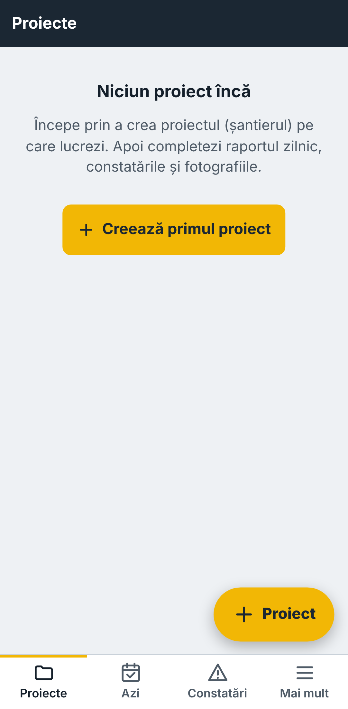

## 2. Setări: firmă, nume, logo

**Mai mult → Setări.** Scrie denumirea firmei și numele tău (apare la „Întocmit” în PDF) și încarcă logo-ul firmei (apare în antetul fiecărui PDF). Tot aici alegi tema (luminoasă / întunecată / automat).

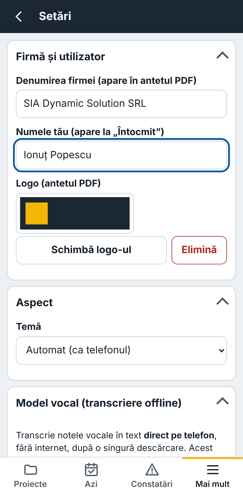

## 3. Proiect nou

Completează denumirea (obligatoriu) și, dacă ai, beneficiarul, numărul contractului, lotul, localitatea, antreprenorul, dirigintele și data începerii. Apasă **„Creează proiectul”**.

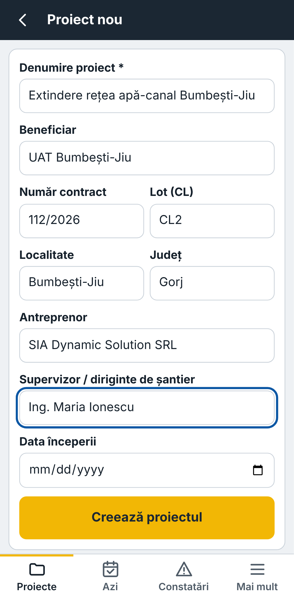

Pagina proiectului are două butoane mari: **„Raportul de azi”** și **„Constatări”**, plus lista rapoartelor zilnice.

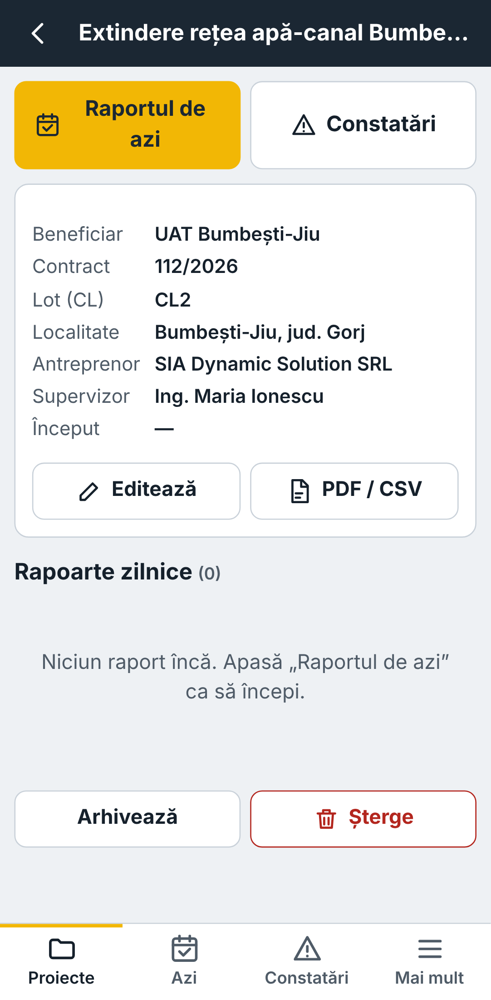

## 4. Raportul zilnic

Apasă **„Azi”** (jos) sau **„Raportul de azi”**. Totul se salvează singur — sus apare **„Salvat”**.

- Bifează vremea (poți alege mai multe) și scrie temperaturile.
- La **Personal** adaugi categorii și numărul de oameni. **„Copiază din ziua precedentă”** preia personalul și utilajele de ieri.
- Secțiunile se deschid și se închid cu o atingere pe titlu.

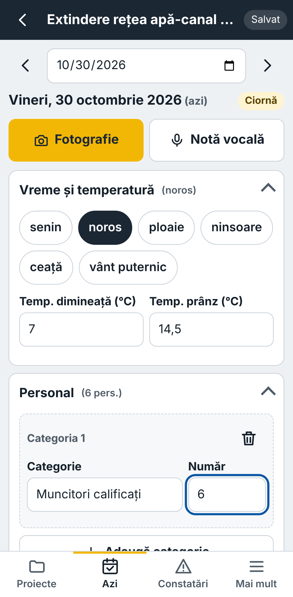

La **Activități executate** scrii ce s-a lucrat, cantitatea, unitatea de măsură și tronsonul.

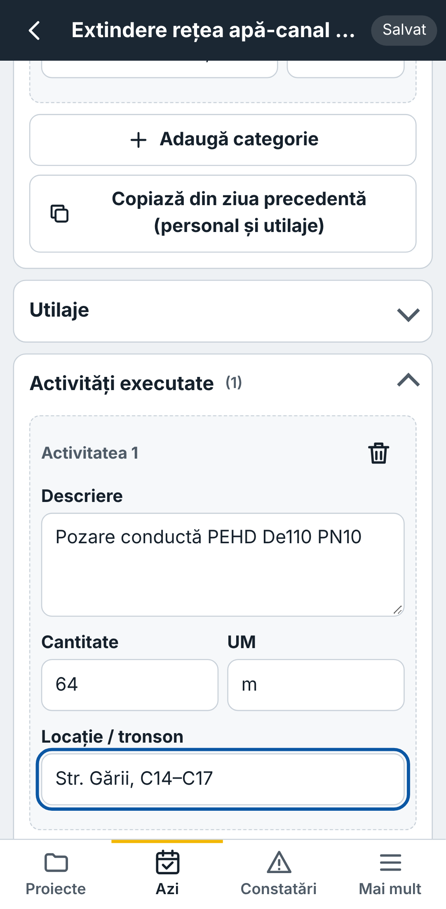

## 5. Fotografii și desen pe fotografie

Butonul galben **„Fotografie”** din raport deschide direct camera (de pe ecranul principal: **Azi → Fotografie**, două atingeri). Poți alege și **„Din galerie”**, mai multe deodată.

Atinge o fotografie → **„Adnotează”**: alege săgeată, cerc, dreptunghi, linie liberă sau text și o culoare, apoi desenează cu degetul. Săgeata întoarsă anulează ultimul pas. **„Salvează adnotările”** — originalul rămâne neatins; desenul îl poți modifica oricând.

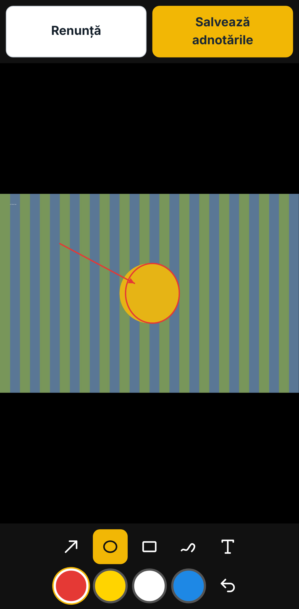

## 6. Finalizare și PDF

Jos în raport: **„PDF raport zilnic”** creează PDF-ul (cu logo, date proiect, tabele, fotografii și căsuțe de semnătură) și îl poți trimite pe WhatsApp, e-mail sau Drive. **„Finalizează raportul”** îl blochează la editare; **„Redeschide”** îl deblochează.

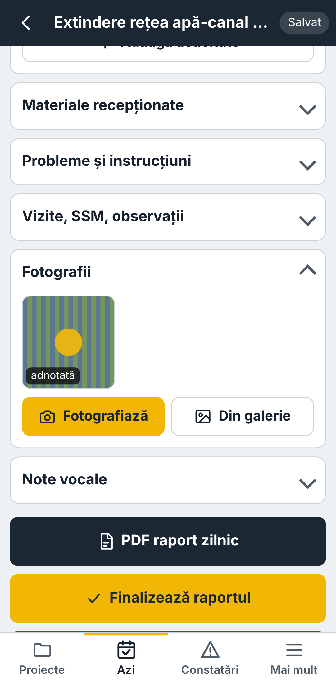

## 7. Constatări (neconformități)

**Constatări → „+ Constatare”.** Completează titlul, categoria, gravitatea, locația, responsabilul și termenul. **„Adaugă poziția GPS”** ia coordonatele (merge fără internet; poate dura până la 20 de secunde; vezi precizia în metri).

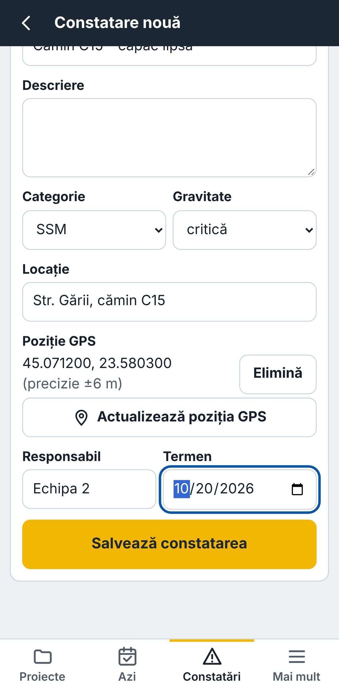

După salvare adaugi fotografiile **„înainte”** și schimbi starea cu butoanele de sus: Deschisă → În lucru → Rezolvată → Verificată (sau Anulată). Fiecare schimbare apare în **Istoric** cu data și ora. După remediere adaugi fotografiile **„după”**.

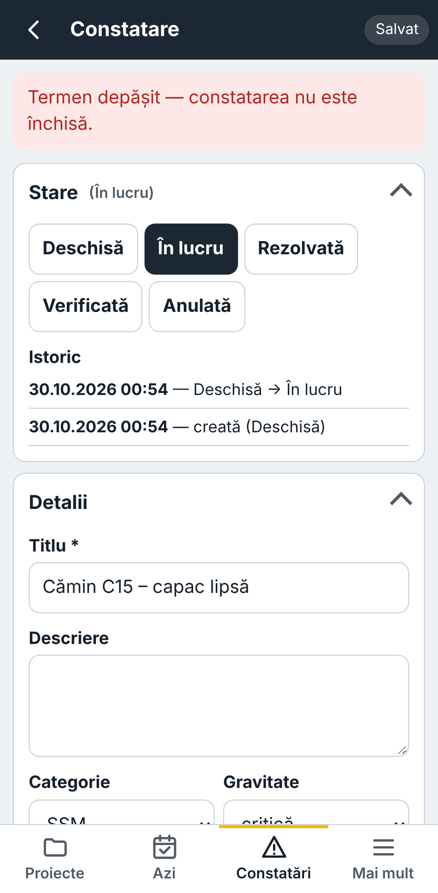

Lista arată întâi constatările cu **termen depășit** (cu roșu). Din **Filtre** alegi starea, gravitatea, responsabilul sau doar cele depășite. Jos: **„PDF listă”** și **„CSV”** (pentru Excel), cu filtrele aplicate.

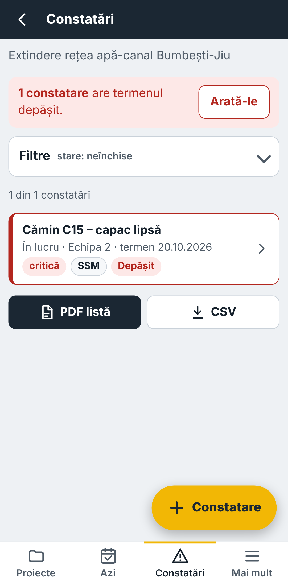

## 8. Rapoarte pe perioadă, Excel și fotografii

**Mai mult → Rapoarte PDF și CSV** (sau „PDF / CSV” din pagina proiectului): alegi intervalul și scoți **PDF raport pe perioadă**, **CSV rapoarte zilnice** pentru Excel sau **Fotografii .zip** (cu data, GPS-ul și proiectul scrise pe imagine).

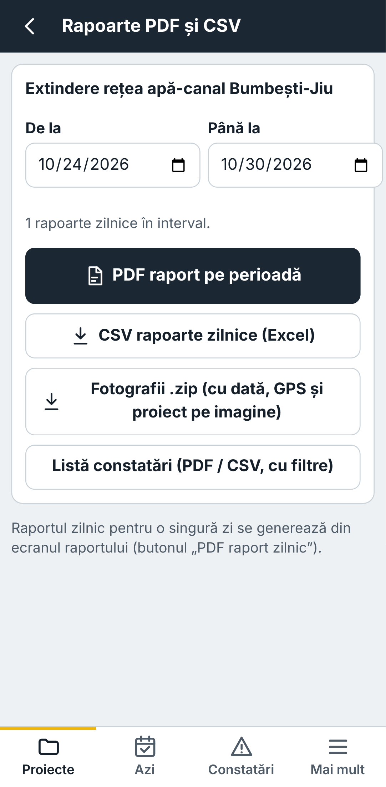

## 9. Note vocale cu transcriere

O singură dată, pe Wi-Fi: **Mai mult → Setări → Model vocal → „Descarcă pentru folosire offline”** (îți arată mărimea înainte să confirmi). „Small” e mai bun pentru română, „base” e mai rapid. Butonul **„Verifică motorul de transcriere”** îți spune dacă telefonul poate rula transcrierea.

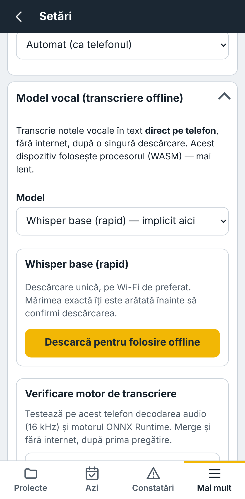

Apoi, în raport sau în constatare: **„Înregistrează notă vocală”** (sau „Atașează fișier audio”, de ex. un mesaj vocal WhatsApp). Textul apare sub înregistrare; **„Inserează textul în…”** îl pune în câmpul ales. Înregistrarea rămâne atașată.

## 10. Copie de siguranță

**Mai mult → Copie de siguranță.** Fă o copie măcar o dată pe săptămână și păstreaz-o pe Drive sau pe e-mail. Pentru restaurare: „Alege fișierul copiei…”, apoi **„Adaugă / actualizează”** (păstrează ce ai pe telefon, adaugă ce lipsește) sau **„Înlocuiește tot”** (pentru telefon nou).

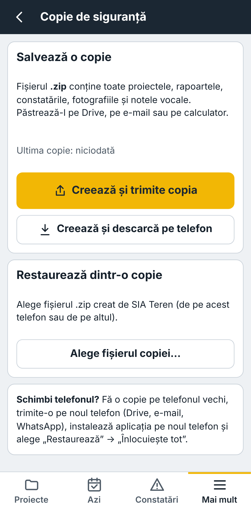

## 11. Mai mult: Coș, arhivă, instalare

Ce ștergi ajunge în **Coș** și poate fi recuperat 30 de zile. Proiectele încheiate le **arhivezi** (dispar din lista principală, rămân în „Proiecte arhivate”). **„Instalează pe telefon”** are pașii pentru Android și iPhone.

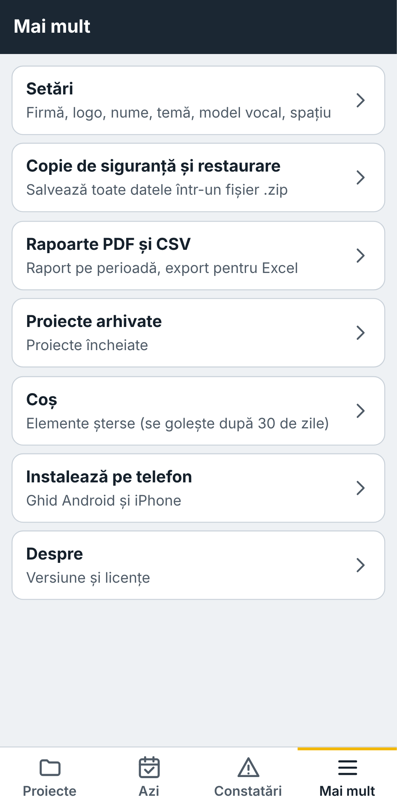

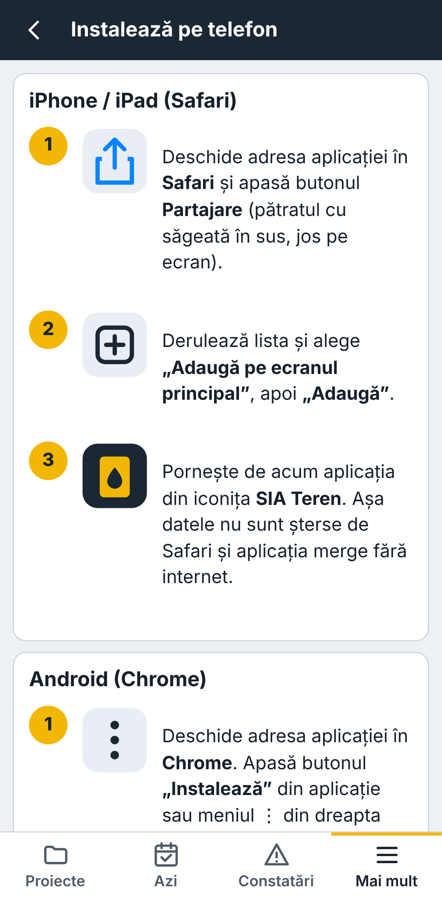
